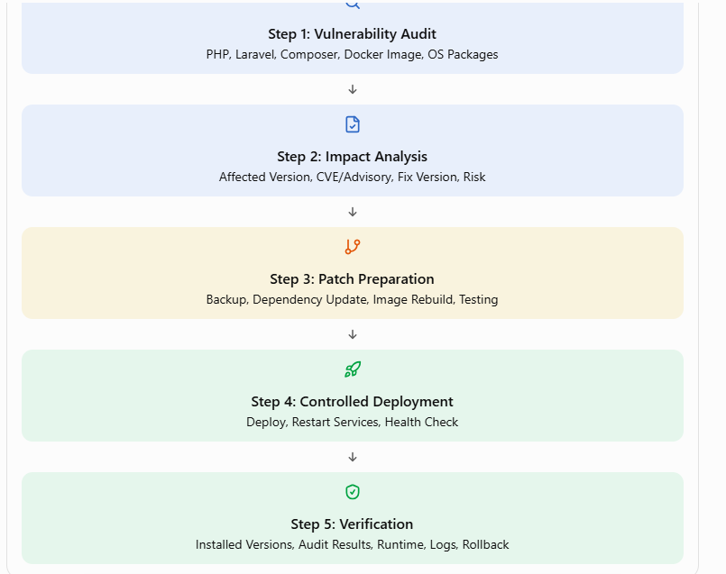

### Laravel + Docker প্রোডাকশনে Vulnerability Check, Patch ও Verification গাইড
 Laravel Application, PHP-FPM, Nginx, MySQL, Queue Worker, Scheduler এবং Reverb থাকলে শুধু Laravel-এর Version চেক করলেই হবে না। 
 PHP Runtime, Composer Dependencies, Docker Base Image, Operating System Packages, Nginx এবং Deployment Configuration—সবগুলো পরীক্ষা করতে হবে।
### কোন কোন স্তরে vulnerability থাকতে পারে
| স্তর |	উদাহরণ | চেক করার টুল |
|---|---|---|
| Composer প্যাকেজ | laravel/framework, guzzle, league/*	| composer audit, Trivy |
| NPM প্যাকেজ	| vite, axios, ইত্যাদি | npm audit, Trivy |
| Docker base image / OS প্যাকেজ |	php:8.x-fpm, nginx, alpine/debian |	Trivy, Docker Scout, Grype |
| PHP runtime নিজে |	PHP ভার্সন (EOL বা পুরনো) |	php -v + php.net supported versions |
| অ্যাপ কনফিগারেশন	| APP_DEBUG=true, .env expose	| ম্যানুয়াল চেক, Enlightn |
| Docker/Host কনফিগ |	root ইউজারে রান, privileged, খোলা পোর্ট |	Dockle, docker-bench-security, Trivy config |
| DB/Redis/অন্য সার্ভিস ইমেজ |	mysql, redis, nginx |	Trivy image scan |
### Security Audit Process


এই vulnerability-গুলোর মধ্যে Remote Code Execution (RCE)-এর ঝুঁকি রয়েছে, যার ফলে বিশেষ পরিস্থিতিতে আক্রমণকারী দূর থেকে সার্ভারে কোড চালানোর সুযোগ পেতে পারে। 
PHP-এর অফিসিয়াল security release এবং CERT-EU advisory অনুযায়ী, আক্রান্ত Runtime-কে patched version-এ আপডেট করাই মূল সমাধান।
### Production Server-এর বর্তমান অবস্থা সংগ্রহ
Patch করার আগে বর্তমান অবস্থার একটি রিপোর্ট তৈরি করা। এতে পরবর্তীতে Update-এর আগে ও পরে তুলনা করা যাবে।
### Docker Container এবং Image পরীক্ষা
Production Server-এ SSH করে নিচের কমান্ড ব্যবহার করতে হবে:
```
# Running containers
docker ps

# All containers, including stopped containers
docker ps -a

# Docker Compose services
docker compose ps

# Container names, images and status
docker ps --format "table {{.Names}}\t{{.Image}}\t{{.Status}}"

# Current image IDs
docker inspect --format \
'{{.Name}} | {{.Config.Image}} | {{.Image}}' \
$(docker ps -q)
```

Docker Compose-এ app, queue, scheduler, reverb, nginx, mysql থাকলে প্রত্যেকটি কোন image থেকে তৈরি হয়েছে তা নোট করা।
### Container-এর ভিতরের PHP Version পরীক্ষা
ধরা যাক PHP-FPM container-এর নাম ihelp-gpel-crm-app।
```
# PHP CLI version
docker exec ihelp-gpel-crm-app php -v

# PHP version number only
docker exec ihelp-gpel-crm-app php -r \
'echo PHP_VERSION, PHP_EOL;'

# PHP loaded configuration
docker exec ihelp-gpel-crm-app php --ini

# PHP extensions
docker exec ihelp-gpel-crm-app php -m
```
__Expected result:__ নির্ধারিত patch version অথবা vendor-এর documented equivalent security-patched build।

শুধু php -v দিয়ে সম্পূর্ণ vulnerability status জানা যায় না। একই PHP version string-এর সঙ্গে vendor-backported security fix থাকতে পারে; আবার PHP version ঠিক দেখালেও অন্য OS package vulnerable থাকতে পারে।
### PHP-FPM Runtime-ও যাচাই করা
Production Application যদি PHP-FPM ব্যবহার করে, তাহলে শুধু আলাদা CLI container নয়, যে container সত্যিকার অর্থে web request serve করে সেটিও পরীক্ষা করতে হবে।
```
# Inspect PHP-FPM container processes
docker exec ihelp-gpel-crm-app ps aux

# PHP-FPM configuration test
docker exec ihelp-gpel-crm-app php-fpm -tt
```
php-fpm binary-এর নাম বা অবস্থান image অনুযায়ী আলাদা হতে পারে। CLI এবং FPM যদি পৃথক container-এ চলে, দুই জায়গাতেই version ও configuration যাচাই করুন।

### Docker Image-এর OS এবং Installed Packages
-Debian/Ubuntu-ভিত্তিক image হলে:
```
docker exec ihelp-gpel-crm-app cat /etc/os-release

docker exec ihelp-gpel-crm-app dpkg-query -W \
  -f='${Package} ${Version}\n'
```
-Alpine-ভিত্তিক image হলে:
```
docker exec ihelp-gpel-crm-app cat /etc/alpine-release

docker exec ihelp-gpel-crm-app apk info -vv
```
OS package list থেকে PHP extension, OpenSSL, libcurl, libxml2, system libraries এবং অন্যান্য dependency-এর অবস্থা বোঝা যায়।

### PHP-FPM ও Queue Worker একই image ব্যবহার করছে কি না
Laravel Application-এ queue worker এবং scheduler থাকলে সেগুলোর image ও runtime-ও পরীক্ষা করা।

```
docker compose exec app php -v
docker compose exec queue php -v
docker compose exec scheduler php -v
```
এখানে app, queue, scheduler প্রকৃত Compose service name দিয়ে প্রতিস্থাপন করতে হবে।
যদি queue container-এর নাম queue না হয়, তাহলে docker compose ps দিয়ে সঠিক নাম খুঁজে নিতে হবে।

__এই ধাপের উদ্দেশ্য:__ PHP-FPM patched হলেও Queue Worker বা Scheduler পুরোনো vulnerable image ব্যবহার করছে কি না, তা নিশ্চিত করা।

### Laravel ও Composer Dependency Vulnerability চেক
Laravel-এর security সমস্যা শুধু Framework-এ সীমাবদ্ধ নয়। symfony/*, guzzlehttp/*, league/*, nesbot/carbon, Spatie packages এবং অন্যান্য transitive dependencies-তেও vulnerability থাকতে পারে।

### Production-এর মতো Environment-এ পরীক্ষা করা
Local project অথবা নিরাপদ CI workspace-এ repository checkout করে নিচের কমান্ডগুলো চালান:
```
# Laravel version
php artisan --version

# PHP version
php -v

# Composer version
composer --version

# Audit the exact locked dependency versions
composer audit --locked

# Audit production dependencies only
composer audit --locked --no-dev

# Verify installed packages against PHP extensions/platform
composer check-platform-reqs --no-dev
```
composer audit --locked lock file-এ থাকা dependency version পরীক্ষা করে। --no-dev ব্যবহার করলে development dependency বাদ যায়। Composer-এর audit command vulnerability advisory, abandoned packages এবং কিছু dependency policy issue শনাক্ত করতে পারে। 

যদি আগে composer audit --locked চালিয়ে o/p:
```
No security vulnerability advisories found
```
তাহলে সেটি ভালো ফল। তবে এর মানে শুধু ওই audit-এ পরীক্ষা করা dependency-গুলোর জন্য কোনো matching advisory পাওয়া যায়নি। Docker OS packages, PHP Runtime, Nginx বা অন্য component নিরাপদ কি না, তা এটি বলে না।

### Composer Dependency-তে Vulnerability পাওয়া গেলে
প্রথমে output সংরক্ষণ করতে হবে:
```
composer audit --locked
composer audit --locked --format=json > composer-audit-before.json
```
তারপর নির্দিষ্ট vulnerable package শনাক্ত করতে হবে:
```
composer show vendor/package-name
composer why vendor/package-name
```
এখানে vendor/package-name-এর জায়গায় audit output-এ পাওয়া package-এর নাম দিতে হবে।
এরপর advisory-তে উল্লেখিত fixed version এবং Laravel version-এর compatibility যাচাই করে তারপর উপযুক্ত dependency update করতে হবে।
উদাহরণস্বরূপ, নির্দিষ্ট package update:
```
composer update vendor/package-name --with-dependencies
```
অথবা security fix-এর জন্য একাধিক dependency update প্রয়োজন হলে:
```
composer update --with-dependencies
```

দ্বিতীয় কমান্ডটি একাধিক dependency version পরিবর্তন করতে পারে। তাই এটি Production Server-এ সরাসরি চালানো ঠিক নয়। প্রথমে feature branch বা security-fix branch-এ চালিয়ে পরীক্ষা করে নিতে হবে।
Update-এর পরে পরিবর্তনগুলো পর্যালোচনা করা:
```
git diff -- composer.json composer.lock

composer validate --strict

composer audit --locked

composer check-platform-reqs --no-dev

php artisan test
```
### Laravel Framework-এর Security Advisory যাচাই
Framework version-এর জন্য নিচের পরীক্ষা করা।
```
# Exact Laravel framework version
composer show laravel/framework

# All Laravel packages
composer show "laravel/*"

# Framework-specific security advisories
composer audit --locked
```
Laravel-এর অফিসিয়াল security advisory তালিকাও পরীক্ষা করতে হবে:
```
https://github.com/laravel/framework/security/advisories?utm_source=chatgpt.com
```

__প্রতিটি advisory-তে দেখা যাবে:__
- Affected versions: কোন version range-এ vulnerability আছে।
- Patched versions: কোন version থেকে fix হয়েছে।
- Severity: Critical, High, Moderate বা Low।
- Impact: Authentication bypass, RCE, XSS, SQL injection, unauthorized access ইত্যাদি।
- Mitigation: Upgrade ছাড়াও কোনো সাময়িক ব্যবস্থা প্রযোজ্য কি না।

কোনো advisory-তে installed version আক্রান্ত range-এর মধ্যে থাকলে, প্রথমে সেই advisory-র fixed version নির্ধারণ করতে হবে। তারপর Laravel 13-এর সঙ্গে compatible patched release-এ update করে regression test চালাতে হবে।

এছাড়া Laravel application configuration-এ APP_DEBUG=false, নিরাপদ session/cookie configuration, authorization policies, validation এবং secret management পরীক্ষা করতে হবে। এগুলো ভালো security practice, তবে vulnerable runtime বা dependency-এর patch-এর বিকল্প নয়।
### Docker Image Vulnerability Scan
Docker container-এ PHP ছাড়াও OS packages ও system libraries থাকে। তাই image scanner ব্যবহার করা উচিত।

এখানে উদাহরণ হিসেবে Docker Scout দেওয়া হলো। প্রতিষ্ঠানের অনুমোদিত Trivy, Grype বা অন্য scanner থাকলে সেটিও ব্যবহার করা যায়।
### বর্তমান Image Scan
প্রথমে image name বের করুন:
```
docker compose images
```
ধরা যাক image:
```
registry.example.com/ihelp-gpel-crm:production
```

এটি একটি উদাহরণ নাম; প্রকৃত image name ব্যবহার করতে হবে।

Docker Scout CLI উপলব্ধ থাকলে:
```
docker scout version

docker scout cves registry.example.com/ihelp-gpel-crm:production

docker scout recommendations registry.example.com/ihelp-gpel-crm:production
```
Docker Scout image-এর software components এবং vulnerability database-এর সঙ্গে সেগুলো মিলিয়ে security finding দেখাতে পারে।

scanner-এ সাধারণত নিচের তথ্য পাওয়া উচিত:

| তথ্য	| কেন প্রয়োজন |
|---|---|
| CVE/GHSA ID |	Vulnerability-এর পরিচিতি |
| Severity | ঝুঁকির মাত্রা |
| Package name |	কোন component আক্রান্ত |
| Installed version |	বর্তমানে কোন version আছে |
| Fixed version |	কোন version-এ fix রয়েছে |
| Exploitability/Reachability |	আপনার ব্যবহারের ক্ষেত্রে ঝুঁকি বোঝার জন্য
| Image digest |	কোন নির্দিষ্ট image পরীক্ষা হয়েছে |

### Scan Result কীভাবে বুঝা যাবে?
- Critical/High, fixed version available: দ্রুত remediation পরিকল্পনা করতে হবে।
- Critical/High, fix unavailable: vendor guidance, exposure reduction ও mitigation বিবেচনা করতে হবে।
- No vulnerabilities found: scanner-এর database, scan coverage এবং image identity যাচাই করতে হবে।
- Unfixed vulnerability: সংশ্লিষ্ট vendor-এর package advisory দেখুন; সব finding-এর তাৎক্ষণিক fix নাও থাকতে পারে।

Image scanner-এ কোনো finding না থাকলেও application code-এর security bug, ভুল authorization, exposed secret বা দুর্বল server configuration বাদ পড়ে যেতে পারে।
### Dockerfile ও Base Image Patch Update
ধরা যাক Dockerfile-এ আছে:
```
FROM php:8.2-fpm
```
এই tag ব্যবহার করে exact patch version নিশ্চিত হওয়া যায় না। PHP security patch-এর জন্য প্রথমে ব্যবহৃত image-এর বর্তমান digest এবং upstream image-এর updated tag যাচাই করতে হবে।
### Base Image Update-এর উদাহরণ
PHP 8.2 ব্যবহার চালিয়ে যেতে হলে, upstream-এ প্রকাশিত patched tag-এর উদাহরণ:
```
FROM php:8.2.35-fpm-bookworm
```
এটি শুধু উদাহরণ। আমার image registry-তে ওই tag আছে কি না, আমার OS ও extension configuration-এর সঙ্গে সামঞ্জস্যপূর্ণ কি না এবং vendor security fixes আছে কি না, তা যাচাই করে ব্যবহার করে নিতে হবে।

সম্ভব হলে Production build-এর জন্য নির্দিষ্ট image digest ব্যবহার করা:
```
FROM php:8.2.35-fpm-bookworm@sha256:REPLACE_WITH_VERIFIED_DIGEST
```
এখানে REPLACE_WITH_VERIFIED_DIGEST অবশ্যই registry থেকে পাওয়া প্রকৃত digest দিয়ে প্রতিস্থাপন করতে হবে। এই placeholder সরাসরি deploy করবেন না।
### Dockerfile-এ OS Package Update
Debian-ভিত্তিক image-এ যদি অতিরিক্ত OS package ইনস্টল করে, Dockerfile-এ package install এবং cleanup একসঙ্গে করা যায়:
```
RUN apt-get update \
    && apt-get install -y --no-install-recommends \
        ca-certificates \
        curl \
    && rm -rf /var/lib/apt/lists/*
```
এখানে গুরুত্বপূর্ণ বিষয় হলো, এই কমান্ড নতুন image build-এর সময় repository থেকে উপলব্ধ package ইনস্টল করবে। কিন্তু এটি নিজে থেকে PHP upstream source version update করার নিশ্চয়তা দেয় না। PHP image tag, PHP binary, OS packages—প্রতিটি আলাদাভাবে যাচাই করতে হবে।

এড়িয়ে চলুন: Production container-এর ভিতরে হাতে apt upgrade চালিয়ে পরিবর্তন রেখে দেওয়া। এতে image reproducibility নষ্ট হতে পারে। Dockerfile এবং build pipeline-এ পরিবর্তন করে নতুন image তৈরি করাই সঠিক পদ্ধতি।
### Image Rebuild ও Scan
```
# Build a new image
docker compose build --pull app queue scheduler

# List locally built images
docker image ls

# Inspect the new image
docker image inspect YOUR_NEW_IMAGE:YOUR_TAG
```
app, queue, scheduler আপনার Compose service name অনুযায়ী পরিবর্তন করুন।

এরপর নতুন image scan করুন:
```
docker scout cves YOUR_NEW_IMAGE:YOUR_TAG
```
নতুন image-এর vulnerability result পুরোনো image-এর সঙ্গে তুলনা করা। Critical/High finding কমেছে কি না, নতুন finding এসেছে কি না এবং কোন finding-এর fix unavailable—এসব নথিভুক্ত করা।
### Production Deployment-এর আগে Backup ও Rollback প্রস্তুতি
Production-এ patch দেওয়ার আগে অবশ্যই rollback পরিকল্পনা রাখতে হবে।
### Deployment Checklist
Production readiness checklist
- বর্তমান Git commit SHA সংরক্ষণ করেছি
- বর্তমান Docker image tag ও digest সংরক্ষণ করেছি
- composer.lock এবং Dockerfile-এর পরিবর্তন review করেছি
- Database backup নিয়েছি এবং প্রয়োজনে restore পরীক্ষা করেছি
- Upload files ও persistent volumes-এর backup যাচাই করেছি
- Staging বা test environment-এ deployment পরীক্ষা করেছি
- Critical/High security findings-এর remediation পরিকল্পনা করেছি
- Rollback image এবং deployment procedure প্রস্তুত রেখেছি
### Database Backup-এর উদাহরণ
MySQL container-এর জন্য:
```
docker exec YOUR_MYSQL_CONTAINER \
  sh -c 'exec mysqldump -u"$MYSQL_USER" -p"$MYSQL_PASSWORD" "$MYSQL_DATABASE"' \
  > production-backup.sql
```
MySQL image-এ environment variable-এর নাম ভিন্ন হতে পারে। Production backup-এ database credentials command line বা logs-এ প্রকাশ না করে secret management ব্যবহার করতে হবে। Backup তৈরি হয়েছে কি না এবং restore করা সম্ভব কি না, সেটিও পরীক্ষা করতে হবে।

শুধু application image rollback করলে database schema-এর পরিবর্তন স্বয়ংক্রিয়ভাবে rollback হয় না। তাই migration-এ destructive পরিবর্তন থাকলে আলাদা পরিকল্পনা প্রয়োজন।
### Jenkins Pipeline-এ Security Check যুক্ত করা
Laravel project Jenkins দিয়ে Docker build ও deploy করলে pipeline-এ vulnerability check বাধ্যতামূলক করা উচিত।

নিচে একটি সাধারণ উদাহরণ দেওয়া হলো। এটি আপনার বিদ্যমান Jenkinsfile-এর সরাসরি replacement নয়; বর্তমান deployment process অনুযায়ী সমন্বয় করতে হবে।
```

pipeline {
    agent any

    stages {
        stage('Checkout') {
            steps {
                checkout scm
            }
        }

        stage('Composer Validation') {
            steps {
                sh 'composer validate --strict'
            }
        }

        stage('Composer Security Audit') {
            steps {
                sh 'composer audit --locked'
            }
        }

        stage('Build Docker Image') {
            steps {
                sh '''
                    docker compose build --pull
                '''
            }
        }

        stage('PHP Runtime Check') {
            steps {
                sh '''
                    docker compose run --rm app php -v
                    docker compose run --rm app php artisan --version
                    docker compose run --rm app composer check-platform-reqs --no-dev
                '''
            }
        }

        stage('Application Tests') {
            steps {
                sh 'docker compose run --rm app php artisan test'
            }
        }

        stage('Image Vulnerability Scan') {
            steps {
                sh '''
                    docker scout cves YOUR_NEW_IMAGE:YOUR_TAG
                '''
            }
        }

        stage('Deploy') {
            steps {
                echo 'Deploy only after required checks pass.'
            }
        }
    }
}
```
এই pipeline-এ কিছু project অনুযায়ী পরিবর্তন করতে হবে:
- app service-এ Composer ও প্রয়োজনীয় runtime tools থাকতে হবে।
- YOUR_NEW_IMAGE:YOUR_TAG-এর জায়গায় প্রকৃত build image ব্যবহার করতে হবে।
- Image scan command finding দেখালেও সব scanner স্বয়ংক্রিয়ভাবে Jenkins build fail করে না। Severity threshold ও exit policy স্পষ্টভাবে configure করতে হবে।
- Database-dependent tests-এর জন্য CI database service বা test environment প্রয়োজন হতে পারে।
- Deployment stage-এ production secrets Jenkins Credentials বা অনুমোদিত secret manager থেকে নিতে হবে।
- docker compose run --rm যদি আপনার app service-এর environment-এ production .env বা required secrets প্রত্যাশা করে, তাহলে আলাদা test configuration ব্যবহার করুন।

স্প্রস্তাবিত নিয়ম: Critical/High vulnerability-এর জন্য approved exception না থাকলে Production deployment আটকে দিন। Exception থাকলে তার কারণ, mitigation, owner এবং review date লিখিত রাখুন।

### Production-এ নতুন Image Deploy করা
আপনার deployment process যদি Docker Compose-ভিত্তিক হয়, তাহলে tested image registry-তে push করে Production Server-এ নির্দিষ্ট version deploy করুন।

সাধারণ উদাহরণ:
```
# Pull the exact tested image
docker compose pull app queue scheduler

# Recreate services with the new image
docker compose up -d --no-deps app queue scheduler
```
application-এর architecture অনুযায়ী reverb বা অন্য PHP service-ও update করতে হতে পারে। nginx-এর image পরিবর্তিত না হলে সেটি অযথা recreate করার প্রয়োজন নেই।

যদি সব service একই image ব্যবহার করে এবং আপনার Compose configuration-এ image tag পরিবর্তন করা হয়ে থাকে, তাহলে সংশ্লিষ্ট service-গুলোকে নতুন image-এ recreate করতে হবে।
Laravel deployment commands
deployment procedure অনুযায়ী:
```
# Clear stale cached bootstrap files
docker compose exec app php artisan optimize:clear

# Apply reviewed database migrations if required
docker compose exec app php artisan migrate --force

# Rebuild production caches
docker compose exec app php artisan config:cache
docker compose exec app php artisan route:cache
docker compose exec app php artisan view:cache
```

সতর্কতা:
- সব পরিবর্তনে migration প্রয়োজন হয় না। প্রয়োজন না থাকলে migration চালালো উচিত না।
- optimize:clear cache store-এর ওপর নির্ভর করে। project-এ cache database বা Redis-এ থাকলে configuration ঠিক আছে কি না নিশ্চিত করা।
- Application-এর routes বা configuration cache করা সম্ভব না হলে সংশ্লিষ্ট command-এর failure উপেক্ষা করা যাবে না।
- Queue Worker-কে নতুন code ব্যবহার করাতে Laravel-এর queue restart প্রয়োজন হতে পারে:

```
docker compose exec app php artisan queue:restart
```
এই command queue worker-কে graceful restart signal দেয়। আপনার Queue Worker আলাদা container-এ থাকলে সেটির process manager ও deployment strategy-ও যাচাই করুন।

Scheduler এবং Reverb থাকলে সেগুলোর container health, logs ও service connectivity পরীক্ষা করুন।

### Update-এর পরে কীভাবে নিশ্চিত হওয়া যায় যে Patch হয়েছে?
এটি পুরো প্রক্রিয়ার সবচেয়ে গুরুত্বপূর্ণ ধাপ। শুধু deployment সফল হওয়া বা container running থাকা যথেষ্ট নয়।
__PHP Version Verification__
```
docker compose exec app php -v
docker compose exec queue php -v
docker compose exec scheduler php -v
```
প্রত্যাশিত ফল:
```
PHP 8.2.35 ...
```
এটি উদাহরণ। নির্বাচিত PHP branch এবং patched image অনুযায়ী প্রকৃত version আলাদা হতে পারে।
__Image Identity Verification__
```
docker compose ps

docker inspect --format \
'{{.Name}} {{.Config.Image}} {{.Image}}' \
$(docker ps -q)
```
পুরোনো image এবং নতুন image-এর digest তুলনা করুন। Deploy-এর পর container সত্যিই নতুন image থেকে তৈরি হয়েছে কি না নিশ্চিত করা।

__Composer Audit আবার চালান__
```
docker compose exec app composer audit --locked

docker compose exec app composer audit --locked --no-dev

docker compose exec app composer check-platform-reqs --no-dev
```
Production image-এ Composer না থাকলে, CI pipeline-এ একই composer.lock দিয়ে audit করুন এবং deployed image-এর dependency manifest-এর সঙ্গে মিলিয়ে নিন।

যদি dependency patch দেওয়া হয়ে থাকে, নতুন composer.lock এবং build artifact যে commit থেকে তৈরি হয়েছে সেটি নিশ্চিত করুন।
### Docker Image Scan পুনরায় করুন
```
docker scout cves YOUR_NEW_IMAGE:YOUR_TAG
```
Deployment-এর পরে registry থেকে ব্যবহৃত exact image digest-টিও scan করুন। Local image এবং Production image একই digest-এর কি না মিলিয়ে নেয়া।

একটি before/after report রাখুন:

|  যাচাই |	Patch-এর আগে |	Patch-এর পরে |
|---|---|---|
| PHP Version	| পুরোনো version |	Fixed version বা vendor-confirmed patched build |
| Laravel Version |	পুরোনো dependency set	| Advisory অনুযায়ী patched dependency |
| Composer Audit |	Findings থাকতে পারে |	সংশ্লিষ্ট advisory আর matching নয় |
| Image Scan | পুরোনো findings |	Fixed findings আর নেই |
| Container Image Digest | পুরোনো digest |	নতুন যাচাইকৃত digest
| Application Tests	| Baseline |	Passed |
| Runtime Health | Baseline	| Healthy |
| Logs	| Baseline	| নতুন error বা regression নেই |

__Runtime ও Application Health Check__
```
# Check running containers
docker compose ps

# Recent logs from the application
docker compose logs --since=15m app

# Queue logs
docker compose logs --since=15m queue

# Scheduler logs
docker compose logs --since=15m scheduler

# Nginx logs
docker compose logs --since=15m nginx
```
তারপর আপনার প্রকৃত health endpoint ব্যবহার করুন:
```
curl -i https://YOUR_PRODUCTION_DOMAIN/health
```
/health endpoint না থাকলে application-এর public health endpoint বা উপযুক্ত authenticated smoke test ব্যবহার করুন। উদাহরণ URL-টি সরাসরি চালানোর আগে প্রকৃত domain ও route দিয়ে প্রতিস্থাপন করা।
যাচাই করা:
- Login ও logout কাজ করছে।
- Lead list, Lead details, Task create/update এবং Call Logs কাজ করছে।
- Database connection স্বাভাবিক।
- Queue job সফলভাবে execute হচ্ছে।
- Scheduler নির্ধারিত কাজ চালাচ্ছে।
- Reverb/WebSocket connection সচল।
- File upload ও Google Sheets integration প্রয়োজনমতো কাজ করছে।
- 500, 502, 504 বা নতুন PHP fatal error হচ্ছে না।
  আপনার CRM-এর ক্ষেত্রে অন্তত Lead, Task, Call এবং dashboard report-এর smoke test করা উচিত।
### Patch-এর পরেও Vulnerability থাকলে কী করা উচিত?
সব vulnerability একইভাবে fix হয় না। নিচের সিদ্ধান্ত পদ্ধতি অনুসরণ করুন।
- Case A: Patch হয়েছে, Finding আর নেই
নতুন image, version, dependency lock file এবং scanner report সংরক্ষণ করুন। Regression test সফল হলে deployment সম্পন্ন বলে বিবেচনা করা।

- Case B: Fixed version-এ আপডেটের পরও Finding আছে
Scanner-এর database refresh, exact image digest, OS vendor advisory, duplicate packages ও পুরোনো image layers পরীক্ষা করুন। Finding-এর affected package আসলেই ব্যবহৃত হচ্ছে কি না যাচাই করুন।

- Case C: Critical Vulnerability, এখনো Patch নেই
Vendor advisory অনুসরণ করুন, internet exposure কমান, অপ্রয়োজনীয় service isolate করুন এবং প্রয়োজনে incident response শুরু করুন। Mitigation-কে permanent fix মনে করবেন না।

### Rollback করার নিয়ম
Patch deploy করার পর Application crash, authentication failure, database error বা গুরুতর regression দেখা দিলে:
- নতুন deployment-এর logs এবং error সংরক্ষণ করা।
- আগের verified image tag/digest-এ ফিরে যাওয়া।
- Application health, database connectivity ও queue status পরীক্ষা করা।
- Destructive database migration থাকলে restore বা forward-fix পরিকল্পনা ছাড়া অন্ধভাবে rollback করা যাবেনা।
- Security patch rollback করলে vulnerable runtime পুনরায় চালু হওয়ার ঝুঁকি থাকে। তাই rollback-এর পর exposure নিয়ন্ত্রণ করে দ্রুত সংশোধিত image তৈরি করুন।
__উদাহরণ:__
```
# Example only: use the exact previous tested image tag
docker compose pull app queue scheduler

# Recreate services using the previous image configuration
docker compose up -d --no-deps app queue scheduler

# Verify service status and logs
docker compose ps
docker compose logs --since=15m app
```
এটি তখনই কাজ করবে যখন Compose configuration-এ আগের image tag পুনরায় নির্ধারণ করা হয়েছে।
শুধু পুরোনো image pull করলেই চলমান service স্বয়ংক্রিয়ভাবে rollback হয় না।
### চূড়ান্ত Production Security Checklist
Patch deployment সম্পন্ন হয়েছে বলার আগে নিচের সবগুলো নিশ্চিত করা:

- PHP-এর installed version patched অথবা vendor-confirmed security-fixed।
- PHP-FPM, Queue Worker, Scheduler ও অন্যান্য PHP runtime একই approved build ব্যবহার করছে।
- composer audit --locked-এ সংশ্লিষ্ট vulnerability আর পাওয়া যাচ্ছে না।
- Laravel ও অন্য vulnerable dependency-গুলো patched version-এ আছে।
- Docker image scan-এ সংশ্লিষ্ট vulnerability আর পাওয়া যাচ্ছে না, অথবা documented exception রয়েছে।
- নতুন image digest Production-এ deploy হয়েছে।
- Jenkins pipeline-এর security checks সাকসেস হয়েছে।
- Application tests ও CRM smoke tests সাকসেস হয়েছে।
- Logs-এ নতুন fatal error বা deployment regression নেই।
- Database backup, rollback image ও recovery procedure প্রস্তুত আছে।
- PHP branch-এর support lifecycle পর্যালোচনা করা হয়েছে।

__সবচেয়ে গুরুত্বপূর্ণ সিদ্ধান্ত:__ Patch update হয়েছে কি না, তা শুধু php -v, composer audit বা docker ps—কোনো একক কমান্ড দিয়ে নিশ্চিত করা যায় না। সঠিক image identity, patched Runtime, dependency advisory, image scan এবং Production smoke test—সবগুলো মিলিয়ে verification করতে হবে।

