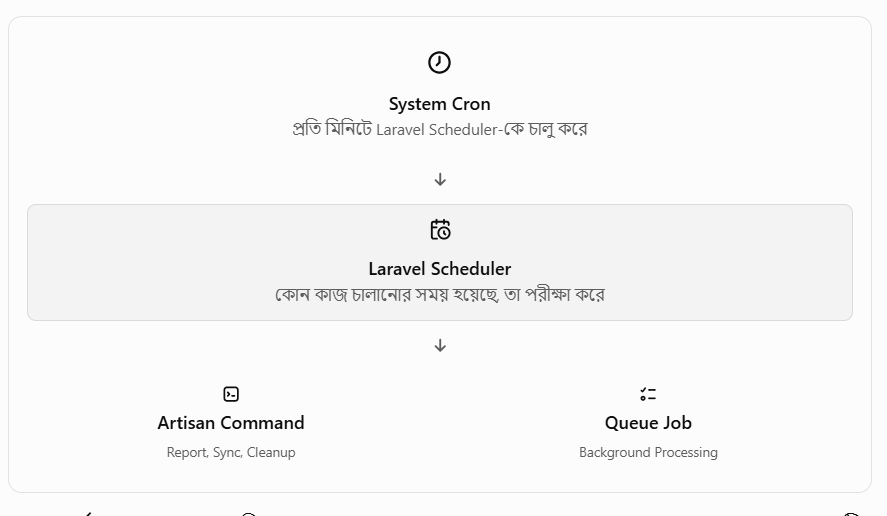
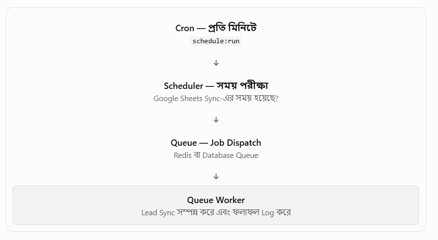

#### Laravel Scheduling কি?
Laravel Scheduling হলো Laravel অ্যাপ্লিকেশনের এমন একটি সুবিধা, যার সাহায্যে নির্দিষ্ট সময় বা নির্দিষ্ট বিরতিতে কোনো কাজ স্বয়ংক্রিয়ভাবে চালানো যায়।

যেমন:-
- প্রতি মিনিটে কোনো ডেটা চেক করা।
- প্রতিদিন রিপোর্ট তৈরি করা।
- Google Sheets থেকে Lead Sync করা।
- পুরোনো Cache পরিষ্কার করা কিংবা। 
- নির্দিষ্ট সময়ে Queue Job চালানো।
- প্রতিদিন রাত ১২টায় ডাটাবেজ ব্যাকআপ।
- প্রতি ঘণ্টায় রিপোর্ট ইমেইল।
- বা প্রতি সপ্তাহে পুরনো ডেটা মুছে ফেলা।
#### Laravel Scheduling কীভাবে কাজ করে?

Laravel Scheduler নিজে সাধারণত সারাক্ষণ চলমান কোনো Process নয়। Production Server-এ একটি System Cron প্রতি মিনিটে php artisan schedule:run চালায়। Laravel এরপর ঠিক করে কোন Scheduled Task চালানো দরকার। 
#### Scheduling-এর মূল উপাদান:
| উপাদান | কাজ |
|---|---|
| Scheduler | কোন কাজ কখন চলবে, তা নির্ধারণ করে |
| Cron | Operating System থেকে Scheduler চালু করে |
| Artisan Command | নির্দিষ্ট কাজের জন্য Laravel CLI Command |
| Queue Job | দীর্ঘ সময়ের কাজ Background-এ প্রসেস করে |
| Queue Worker | Queue-তে থাকা Job গ্রহণ ও Execute করে |
| Mutex / Lock | একই কাজ একাধিকবার চলা ঠেকাতে সাহায্য করে |
| withoutOverlapping() | আগের Execution শেষ না হলে নতুন Execution আটকায় |
| onOneServer() | সমর্থিত Shared Cache ব্যবহারে একাধিক Server-এ একই Scheduled Task-এর Duplicate Execution ঠেকাতে সাহায্য করে |

নোট: Scheduling এবং Queue এক জিনিস নয়। Scheduling ঠিক করে কখন কাজ শুরু হবে; Queue ঠিক করে Background-এ Job কীভাবে প্রসেস হবে।
#### Schedule কোথায় লিখবেন? 
Laravel 13-এ সাধারণত routes/console.php ফাইলে Scheduled Task সংজ্ঞায়িত করা যায়। Laravel-এর অফিসিয়াল ডকুমেন্টেশন অনুযায়ী, bootstrap/app.php-এর withSchedule() পদ্ধতিতেও Schedule সংজ্ঞায়িত করা সম্ভব।
```
laravel-project/
├── app/
│   ├── Console/
│   │   └── Commands/
│   │       └── GenerateDailyReport.php
│   └── Jobs/
│       └── SyncGoogleSheetLeadsJob.php
├── routes/
│   └── console.php
├── bootstrap/
│   └── app.php
└── .env
```
কোন ফাইলে Schedule লিখতে হবে, তা Laravel Version এবং প্রজেক্টের Configuration-এর ওপর নির্ভর করে। Laravel 11–13-এর নতুন অ্যাপ্লিকেশনে routes/console.php একটি সাধারণ জায়গা। 
```
<?php

use Illuminate\Support\Facades\Schedule;
use App\Jobs\SyncGoogleSheetLeadsJob;

// প্রতি মিনিটে এই কাজটি চলবে
Schedule::call(function () {
    logger('Laravel scheduler is working!');
})->everyMinute();


Schedule::job(new SyncGoogleSheetLeadsJob())
    ->everyFifteenMinutes()
    ->withoutOverlapping();
```
#### Frequency Options (কত সময় পর পর চলবে) 

| মেথড | অর্থ |
|---|---|
| ->everyMinute() | প্রতি মিনিটে |
| ->everyFiveMinutes() | প্রতি ৫ মিনিটে |
| ->everyThirtyMinutes() | প্রতি ৩০ মিনিটে |
| ->hourly() | প্রতি ঘণ্টায় |
| ->hourlyAt(17) | প্রতি ঘণ্টার ১৭ মিনিটে |
| ->daily() | প্রতিদিন রাত ১২:০০ এ |
| ->dailyAt('13:00') | প্রতিদিন দুপুর ১টায় |
| ->twiceDaily(1, 13) | দিনে দুইবার (১টা ও ১৩টা) |
| ->weekly() | প্রতি রবিবার ১২:০০ এ |
| ->weeklyOn(1, '8:00')| প্রতি সোমবার সকাল ৮টায় |
| ->monthly() | প্রতি মাসের ১ তারিখে |
| ->monthlyOn(4, '15:00') | প্রতি মাসের ৪ তারিখ বিকাল ৩টায় |
| ->quarterly() | প্রতি কোয়ার্টারে |
| ->yearly() | প্রতি বছরে |
| ->cron('* * * * *') | কাস্টম Cron expression |

#### প্রয়োজনীয় Artisan Commands
| Command | কাজ |
|---|---|
| php artisan schedule:list | সব schedule ও পরবর্তী রানের সময় দেখায়
| php artisan schedule:run | এই মুহূর্তে যেগুলোর সময় হয়েছে সেগুলো চালায় | 
| php artisan schedule:work | লোকালে প্রতি মিনিটে স্বয়ংক্রিয়ভাবে চালায় |
| php artisan schedule:test | একটি নির্দিষ্ট task বেছে টেস্ট রান করে |
| php artisan schedule:interrupt |  চলমান schedule:work বা deploy এর সময় সবকিছু থামাতে সাহায্য করে |
| php artisan schedule:clear-cache | আটকে থাকা Scheduler Lock পরিষ্কার করা |
| php artisan schedule:pause | Scheduler সাময়িকভাবে Pause করা | 
| php artisan schedule:continue | Pause করা Scheduler পুনরায় চালু করা |

#### withoutOverlapping() কী এবং কেন ব্যবহার করা হয়? 

যেমন: 
Google Sheets Sync করতে ৮ মিনিট সময় লাগে, কিন্তু যদি প্রতি ৫ মিনিটে Sync Schedule করানো হয় তাহলে
- সকাল ১০:০০ — প্রথম Sync শুরু।
- সকাল ১০:০৫ — প্রথম Sync শেষ হয়নি।
- কোনো Overlap Protection না থাকলে — দ্বিতীয় Sync-ও শুরু হতে পারে।
  
এতে Duplicate Processing, Database Load বা একই Lead বারবার আপডেট হওয়ার সমস্যা হতে পারে।
সমাধান:
```
Schedule::command('leads:fetch-google-sheet')
    ->everyFiveMinutes()
    ->withoutOverlapping(15);
```

এখানে 15 হলো Lock-এর মেয়াদ মিনিটে। আগের Execution চলমান থাকলে নতুন Execution আটকাতে এটি সাহায্য করে। ডিফল্ট Lock মেয়াদ ২৪ ঘণ্টা। 

আরও দুটি বিষয়:
- Lock ব্যবহারের জন্য Cache Driver-কে Lock সমর্থন করতে হবে।
- কোনো Task অস্বাভাবিকভাবে আটকে গেলে Lock পরিষ্কার করতে php artisan schedule:clear-cache ব্যবহার করা যায়। সাবধানে ব্যবহার করতে হবে, কারণ সক্রিয় Lock মুছে গেলে Overlap হতে পারে।
#### onOneServer() কখন দরকার? 
যদি একই CRM-এর দুই বা ততোধিক Server-এ Scheduler চালু থাকে, তাহলে একই Scheduled Task একাধিক Server-এ চলার ঝুঁকি থাকে। 
```
Schedule::command('reports:daily')
    ->dailyAt('23:00')
    ->name('crm-daily-report')
    ->onOneServer();
```
onOneServer()-এর জন্য সব Server-কে একই Shared Cache Store ব্যবহার করতে হয়। Database বা Redis Cache এ ক্ষেত্রে উপযুক্ত হতে পারে। 
 এখানে, name() দিয়ে Scheduled Task-টির পরিচয় নির্দিষ্ট করা হয়েছে।
 
নোট:- withoutOverlapping() এবং onOneServer() আলাদা সমস্যা সমাধান করে। একটি আগের Execution-এর সঙ্গে Overlap ঠেকায়; 
অন্যটি একাধিক Server থেকে একই Schedule চালানো ঠেকায়।
#### runInBackground() কী? 
একই সময়ে একাধিক Scheduled Command চলার কথা থাকলে, দীর্ঘ সময়ের Command পরবর্তী Command-কে দেরি করাতে পারে। runInBackground() Command-কে Background-এ চালাতে সাহায্য করে। 
```
Schedule::command('reports:generate')
    ->daily()
    ->runInBackground();

Schedule::command('leads:fetch-google-sheet')
    ->everyFifteenMinutes()
    ->runInBackground();
```
এই Method Schedule::command() এবং Schedule::exec()-এর Scheduled Task-এর জন্য প্রযোজ্য।
Queue Job ব্যবহার করা আর runInBackground() ব্যবহার করা এক নয়। দীর্ঘ সময়ের Business Process-এর ক্ষেত্রে Queue সাধারণত বেশি উপযোগী; runInBackground() হলো Scheduled Command বা Shell Command-এর Execution পদ্ধতি।
#### Production Server-এ Scheduling চালু করা 
এটি সবচেয়ে গুরুত্বপূর্ণ অংশ। কোডে Schedule লিখলেই Production-এ স্বয়ংক্রিয়ভাবে চলতে শুরু করে না। Server-এ Scheduler Trigger কনফিগার করতে হয়।
#### Linux Server / VPS
Server-এ SSH দিয়ে লগইন করে Cron Editor ওপেন করা:

crontab -e

এরপর এই লাইনটি যোগ করা: 
```
* * * * * cd /var/www/html/your-crm && /usr/bin/php artisan schedule:run >> /dev/null 2>&1
```

নিজের Project Path এবং PHP Binary Path ব্যবহার করতে হবে। CRM-এর Project Path যদি /var/www/html/saas-crm-ihelp হয়, তাহলে সেই Path বসাতে হবে।

এই Cron প্রতি মিনিটে:

- Project Directory-তে প্রবেশ করবে।
- Laravel-এর schedule:run চালাবে।
- Laravel নির্ধারণ করবে কোন Task চালানোর সময় হয়েছে।
  
__Cron Configuration যাচাই করা:__
```
crontab -l
Scheduler-এর Task List দেখা: 
php artisan schedule:list
```

Laravel-এর অফিসিয়াল পদ্ধতিতে সাধারণত প্রতিটি Scheduled Task-এর জন্য আলাদা Cron না লিখে একটি Cron Entry-ই যথেষ্ট। 

#### Windows / Laragon-এ Scheduling
Windows ও Laragon এ, লোকাল Development-এ সবচেয়ে সহজ পদ্ধতি হলো:
```
cd D:\laragon\www\your-crm
php artisan schedule:work
php artisan schedule:work
```
এটি Terminal-এ চালু রাখুন।
আরও একটি উপায় হলো Windows Task Scheduler ব্যবহার করা। সেখানে প্রতি মিনিটে schedule:run চালানোর জন্য Task কনফিগার করা যায়। তবে প্রতিবার Command চালানোর সময় Working Directory, PHP Executable এবং Task-এর Execution Duration সঠিকভাবে নির্ধারণ করতে হবে। এক মিনিটের বেশি চলা Task-এর জন্য অপ্রয়োজনীয় Overlapping এড়ানো জরুরি।
#### Docker / Jenkins Deployment
Docker-ভিত্তিক CRM-এ Scheduler-এর জন্য আলাদা Process বা Container রাখা যেতে পারে। অথবা বিদ্যমান Scheduler Container-এ Cron কনফিগার করা যেতে পারে।

__একটি সহজ ধারণাগত উদাহরণ:__
```
docker exec ihelp-gpel-crm-app php artisan schedule:list
```
এটি Container-এর ভিতরের Scheduled Task-এর তালিকা দেখাবে।

__Scheduler পরীক্ষা করার জন্য:__
```
docker exec ihelp-gpel-crm-app php artisan schedule:run
```
docker exec ihelp-gpel-crm-app php artisan schedule:run
এটি একবার Schedule পরীক্ষা করবে; স্থায়ীভাবে Scheduler চালু করবে না।

Production-এ সাধারণত দুটি উপায় আছে:
- Host Server-এর Cron থেকে App Container-এর ভিতরে schedule:run চালানো।
- আলাদা Scheduler Container বা Process চালু রাখা, যা নিয়মিত Scheduler Trigger করবে।
  
__সতর্কতা:__ একই Application-এর একাধিক Container বা Server-এ Scheduler Trigger চালু করলে Duplicate Execution হতে পারে। একাধিক Server-এর জন্য onOneServer() এবং Shared Cache ব্যবহার করার বিষয়টি বিবেচনা করা।
#### Laravel Scheduling এবং Queue — পার্থক্য 
| বিষয় | Scheduling | Queue |
|---|---|---|
| মূল উদ্দেশ্য | কখন কাজ চলবে নির্ধারণ | Background-এ কাজ প্রসেস |
| Trigger | Cron বা schedule:work | Queue Worker | 
| উদাহরণ | প্রতি ১৫ মিনিটে Lead Sync | ৫০,০০০ Lead Import |
| দীর্ঘ কাজের জন্য | Job Dispatch করা ভালো | উপযুক্ত |
| আলাদাভাবে চালু রাখতে হয়? | হ্যাঁ, Scheduler Trigger দরকার | হ্যাঁ, Worker দরকার |

একটি বাস্তব Workflow: 


#### Common Problems এবং Troubleshooting 
| সমস্যা | কী পরীক্ষা করা উচিত |
|---|---|
| Schedule চলছে না | Cron Entry, schedule:work বা Scheduler Container চালু আছে কি না |
| Task List ফাঁকা | routes/console.php এবং Schedule Registration | 
| Job Queue-তে জমে আছে | Queue Worker, Queue Connection ও Failed Jobs |
| একই কাজ বারবার চলছে | Duplicate Cron, একাধিক Scheduler ও Overlap Lock |
| ভুল সময়ে চলছে | Server Timezone, timezone('Asia/Dhaka') এবং System Clock |
| Lock-এর কারণে Task চলছে না |Lock Expiry ও schedule:clear-cache |
| Production-এ কাজ করছে না | .env, File Permission, Command Path এবং Production Logs |

__Scheduled Task আছে কি না__
php artisan schedule:list

__একবার Scheduler চালিয়ে পরীক্ষা__
php artisan schedule:run -v

__Queue-তে কী অবস্থা__
php artisan queue:failed

__Laravel Log দেখুন__
Linux-এ Log দেখতে: 
```
tail -f storage/logs/laravel.log

Docker-এ Scheduler বা Queue Container-এর Log দেখতে: 
docker logs --tail 100 -f <container-name>
```
#### Production-এ ভালো ক্যারেক্টার
- Idempotency: একই Job পুনরায় চললেও যেন Duplicate Lead, Report বা Call Record তৈরি না হয়।
- Locking: দীর্ঘ কাজের ক্ষেত্রে withoutOverlapping() বিবেচনা করা।
- Retries: Queue Job ব্যর্থ হলে যথাযথ Retry এবং Backoff Policy রাখা।
- Logging: সফলতা, ব্যর্থতা, শুরু ও শেষের সময় Log করা।
- Monitoring: Failed Jobs, Queue Backlog এবং Scheduled Task-এর Execution পর্যবেক্ষণ করা।
- Timezone: ব্যবসায়িক সময়সূচির জন্য Asia/Dhaka ব্যবহার করুন; Server Timezone আলাদা হলেও যেন নির্ধারিত সময় ঠিক থাকে।
- Resource Management: বড় Import বা Report সরাসরি Scheduler-এর ভিতরে না চালিয়ে Queue Job ব্যবহার করা।
- Database Safety: একই সময়ে চলা Job-এর জন্য Transaction, Unique Constraint এবং যথাযথ Locking বিবেচনা করা।
- Deployment: নতুন Code Deploy করার পর দীর্ঘমেয়াদি Worker ও Sub-minute Scheduler-এর Restart/Interrupt প্রয়োজন কি না যাচাই করা।

__সারকথা:__ Laravel Scheduling হলো সময় অনুযায়ী কাজ স্বয়ংক্রিয় করার ব্যবস্থা। CRM-এ Scheduler দিয়ে নির্ধারণ করে কখন Lead Sync, Report Generation বা Cleanup হবে; Queue দিয়ে দীর্ঘ কাজ Background-এ প্রসেস করা; আর Cron বা Scheduler Process দিয়ে Production-এ এই ব্যবস্থা চালু রাখবেন। 


